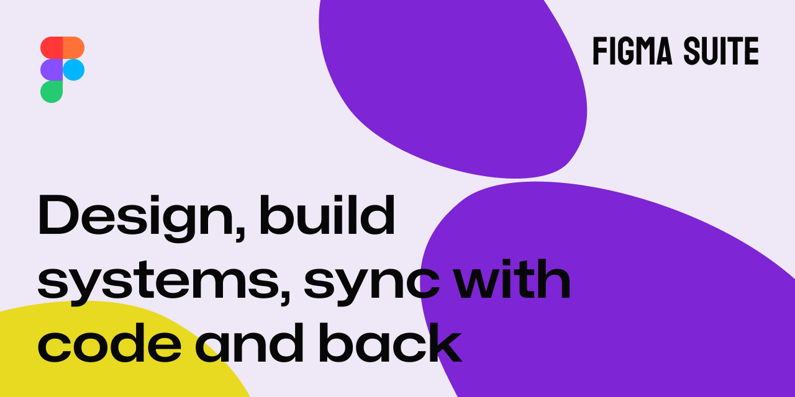

# figma-suite

A Claude Code skill for teams that have both a codebase and a Figma file. It keeps tokens, components and design guidance in sync between the two, and it designs screens the way a careful senior product designer would: complete first, then clear, then restrained.

It builds on Figma's official skills instead of copying them, and adds:

- **One contract, kept in sync.** Token values, validated component mappings (`component-mappings/`, code prop ↔ Figma property) and a project `DESIGN.md` each have one owner. `sync` covers all four lanes (tokens, components, mapping, DESIGN.md), shows the cascade of a change in one dry run, and records hashes so any workflow can tell if the contract is stale.
- **A screen workflow with taste.** Brief → content inventory → structure → build from your own components → mechanical slop scan → subtract pass → review by a separate agent. It targets the generic-AI tells (an icon in every button, a description under every title, eyebrows, nested cards, badge spam, filler copy) without stripping platform chrome, icons the platform expects, or density.
- **Audit** of a screen, page or component against the design system and the project's taste, with severity and rule IDs.

## Requirements

- [Claude Code](https://claude.com/claude-code)
- The official [Figma MCP server](https://developers.figma.com/docs/figma-mcp-server/remote-server-installation/) and its skills: `claude plugin install figma@claude-plugins-official`
- Figma files with edit access
- Node 18+ for the bundled checks (no `npm install`)

## Install and update

```bash
/plugin marketplace add robukh/figma-suite
/plugin install figma-suite@figma-suite
```

Update after a new release:

```bash
claude plugin marketplace update figma-suite   # refresh the catalog from GitHub
claude plugin update figma-suite@figma-suite   # install the new version
```

Then restart Claude Code, or run `/reload-plugins` in the open session. In the UI: `/plugin` → Installed → figma-suite → Update now. Third-party marketplaces do not auto-update by default; turn it on under `/plugin` → Marketplaces → figma-suite → Enable auto-update. Releases are tagged (`v2.0.0`, …); to stay on one, add the marketplace as `robukh/figma-suite#v2.0.0`.

Only one copy may be installed. A skill folder from `npx skills add` or a manual copy (`~/.claude/skills/figma-suite`, `.claude/skills/figma-suite`) can load instead of the plugin, with the old workflow. If `/figma-suite` behaves like an older version, check the "Base directory for this skill" line in the skill header: it must point into `plugins/cache/figma-suite`. Remove the other copy.

Other routes: `npx skills add robukh/figma-suite` (update with `npx skills update`), or copy `skills/figma-suite/` into `.claude/skills/` or `~/.claude/skills/` and re-copy to update.

## Usage

```
/figma-suite                    # first run: setup; afterwards: menu + project snapshot
/figma-suite setup              # scan code + Figma, write the workspace and DESIGN.md (also upgrades 1.x); done when check-contract --setup passes
/figma-suite sync               # tokens + components + mapping + DESIGN.md, one approval
/figma-suite sync --tokens | --components | --to-figma | --to-code
/figma-suite design <desc>      # design a screen or flow
/figma-suite design-md          # create or refresh the project DESIGN.md
/figma-suite build-library      # build or update the component library in Figma
/figma-suite audit              # read-only review of a screen, page or component
/figma-suite update-guide       # publish DESIGN.md to Figma docs, or pull notes back
```

## How it works

| Fact | Owner | Appears elsewhere as |
|---|---|---|
| Token values | code token source (Figma variables when standalone) | DESIGN.md front matter (generated), Figma variables |
| Component structure | `component-mappings/{id}.json` | DESIGN.md `components:` keeps only id and usage policy |
| Usage policy, taste, voice, project decisions | `DESIGN.md` (authored) | never overwritten by sync |

- `scripts/check-contract.mjs` validates mappings and DESIGN.md and cross-checks them (every component has a mapping, token references resolve, variants exist, contrast, freshness). Workflows run it for you.
- **DESIGN.md** uses the open format (YAML tokens plus prose) with a `mode` (`operate`, `consumer`, `persuade`, `read`) and a **Project decisions** section where a team earns back an anti-slop default. Derived facts stay `inferred` until confirmed. Template: [design-md-template.md](skills/figma-suite/reference/design-md-template.md).
- **Anti-slop** is layered: [craft-floor.md](skills/figma-suite/reference/craft-floor.md) is the short list read while drawing, [anti-slop.md](skills/figma-suite/reference/anti-slop.md) the full catalog (rule IDs, ban or default, exceptions), `scripts/slop-scan.min.js` checks about 27 patterns on a frame through `use_figma`, and [critique-rubric.md](skills/figma-suite/reference/critique-rubric.md) drives the fresh-context review.
- **Components** get TEXT properties with Show toggles, native SLOT or INSTANCE_SWAP regions, bound variables, Text Styles, auto-layout and a verification table. Reasoning: [component-craft.md](skills/figma-suite/reference/component-craft.md).

## Layout of this repo

```
.claude-plugin/        plugin.json, marketplace.json
skills/figma-suite/
├── SKILL.md           router, contract, safety rules (agents start here)
├── workflows/         setup, sync, build-library, design-screen, design-md, audit, update-guidelines
├── reference/         one topic per file; each workflow names the ones it needs
├── scripts/           check-contract, discover, slop-scan(.min), verify-component (no dependencies)
├── schema/            JSON Schemas
└── evals/             deterministic tests, behavior evals, fixtures, recorded results
```

`setup` writes a workspace to `{project}/.figma-suite/` (or `~/.claude/figma-suite/{project}/`): `config.json`, `component-mappings/`, generated notes and `state.json`. `DESIGN.md` lives at the project root.

Upgrading from 1.x: `setup` migrates `design-rules.md` into `DESIGN.md` (after asking). The zod validator is replaced by `check-contract.mjs`; existing mapping files stay valid. See the [CHANGELOG](CHANGELOG.md).

## Security

The only external runtime dependency is the [official Figma MCP server](https://developers.figma.com/docs/figma-mcp-server/remote-server-installation/) (`https://mcp.figma.com/mcp`), operated by Figma. `use_figma` sends Plugin API code there to run in your authenticated Figma session, limited to files you can edit. The skill never sees or stores credentials. Bundled scripts are local and read-only, except `check-contract.mjs --write-state`, which writes `state.json`. Tools that publish or upload are not pre-approved and prompt every time. Report issues through a private security advisory on this repository.

## Contributing

Run `node skills/figma-suite/evals/fixtures/contract.test.mjs`, `node skills/figma-suite/evals/fixtures/slop-scan.test.mjs` (and again with `SCAN_FILE=slop-scan.min.js`) and `node skills/figma-suite/evals/check-links.mjs`. Maintainers: `plugin.json` sets an explicit `version`, so users only receive a change when that string is bumped (and the release is tagged); a push without a bump changes nothing for them. After editing `slop-scan.js`, rebuild the minified file with `node skills/figma-suite/scripts/build-slop-scan-min.mjs` (needs `bun`).

## License

MPL-2.0 — see [LICENSE](LICENSE)
